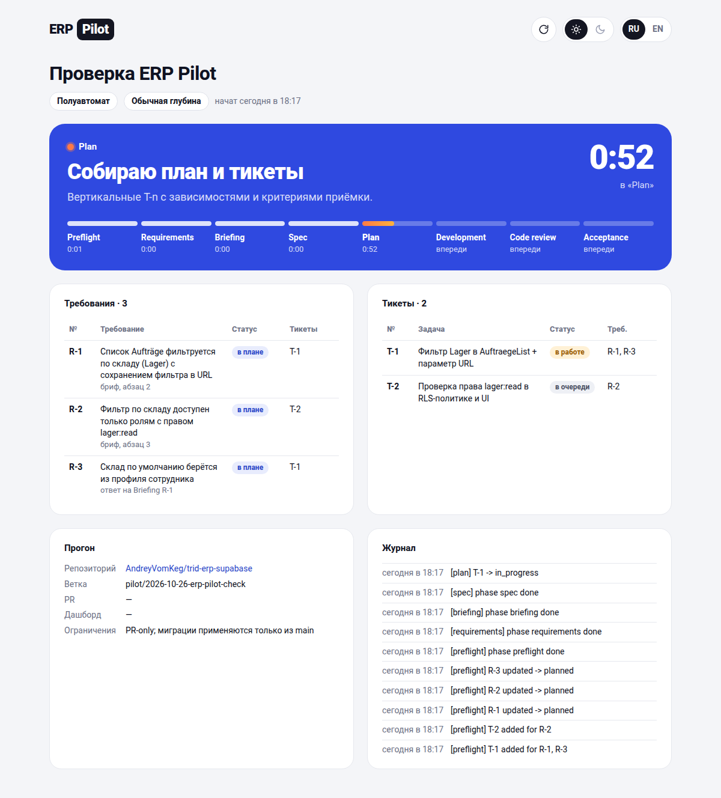

# erp-pilot-skill

[](https://app.skillverdict.dev/github.com/AndreyVomKeg/erp-pilot-skill/erp-pilot)
[](https://kukilab.dev/?check=https%3A%2F%2Fgithub.com%2FAndreyVomKeg%2Ferp-pilot-skill%2Ftree%2FHEAD%2Ferp-pilot)
[](https://github.com/AndreyVomKeg/erp-pilot-skill/actions/workflows/kukilab-scan.yml)
[](https://github.com/AndreyVomKeg/erp-pilot-skill/actions/workflows/validate.yml)
[](LICENSE)

Skill «ERP Pilot» для Perplexity Computer: проводит изменение ERP, учётного или административного портала
(любой репозиторий с базой данных, правами доступа и веб-клиентом) от брифа до приёмки по восьми этапам —
Preflight → Requirements → Briefing → Spec → Plan → Development → Code review → Acceptance — со сквозной
трассировкой «требование → спека → тикет → приёмка», защищёнными воротами и живым дашбордом.

```
erp-pilot/                 # сам skill (папка = name в SKILL.md)
  SKILL.md                 # хаб: режимы, глубина, 8 шагов, границы
  references/phases.md     # чек-лист Preflight, вход/выход этапов, таблица глубины, чек-лист ревью
  references/dashboard.md  # схема state.json, тексты этапов RU/EN, публикация дашборда
  scripts/pilot.py         # CLI состояния прогона (stdlib) с защитами; scripts/README.md — команды и правила
  templates/*.md           # requirements / spec / plan / acceptance
  assets/dashboard/        # шаблон дашборда (RU/EN, светлая/тёмная тема)
examples/demo-run/         # пример прогона с заполненными артефактами и отрендеренным дашбордом
tests/test_pilot.py        # тесты защит pilot.py (unittest, без зависимостей)
```



## Что гарантирует скрипт

- Этапы открываются строго по порядку; `phase <id> done` закрывает этап только без пропусков трассировки
  (включая строки `| R-n |` в `requirements.md`/`acceptance.md` и заголовки `### S-n — R-n` в `spec.md`).
- `requirements` и `acceptance` нельзя пропустить; остальные этапы — только активный или следующий.
- Статусы требований идут только вперёд; `dropped` требует причину; возврат назад и закрытие с пропусками
  возможны только явными флагами `--reopen` / `--force` и попадают в журнал и отчёт.
- Тикет без требования не создаётся; смена статуса тикета пересчитывает статус требования.

## Установка в Perplexity

```bash
cd erp-pilot-skill && zip -r erp-pilot.zip erp-pilot
```
Загрузить `erp-pilot.zip` на странице Skills (My Skills или в проект). Либо попросить Computer:
«добавь skill из репозитория <owner>/erp-pilot-skill».

## Проверка

```bash
python3 -m unittest discover -s tests -v                       # защиты pilot.py
python3 erp-pilot/scripts/pilot.py --dir examples/demo-run status
python3 erp-pilot/scripts/pilot.py --dir examples/demo-run check --phase plan
python3 erp-pilot/scripts/pilot.py --dir examples/demo-run render --out /tmp/dashboard.html
agentskills validate erp-pilot/                                # если установлен валидатор Agent Skills
```

CI (`.github/workflows/validate.yml`) гоняет тесты, smoke-прогон и проверку frontmatter при каждом push и PR.

## Вспомогательные навыки проекта

ERP Pilot не привязан к конкретным проектам. Если у целевого проекта есть свои навыки для опроса/ADR,
разбивки на тикеты, ревью кода, диагностики или дизайн-системы, в Preflight они записываются по ролям
(`pilot.py set --helper review=<имя> …`) и используются на соответствующих этапах; иначе работают встроенные
чек-листы из `references/phases.md`.

## Лицензия

MIT — см. [LICENSE](LICENSE).
